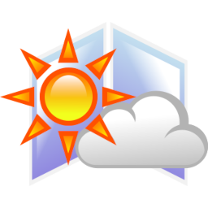

# OpenSkybox

OpenSkybox is a free, open-source skybox editor meant to provide a simple and intuitive way to create customizable skies for video games, animations, and other 3D media/applications.

### Development Status

⚠️ **WARNING: Software Under Development.**

OpenSkybox is currently in an early stage of development and has not undergone comprehensive testing. Features may be incomplete, and bugs should be expected.

**Use at your own risk.** The software is provided "as is", without warranties, as described in the MIT License.

## Dependencies

- GLAD
- GLFW
- Dear ImGui
- Stb
- nativefiledialog-extended (manually added because `vcpkg` had some issues downloading it)

## License

OpenSkybox is licensed under the MIT License.

The project aims to allow users to freely use the skyboxes they create, including in commercial projects, without royalties or attribution requirements.